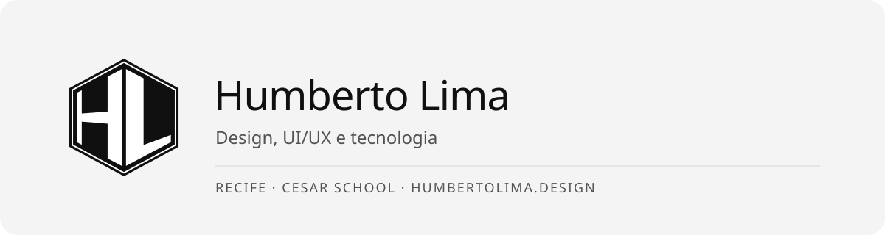
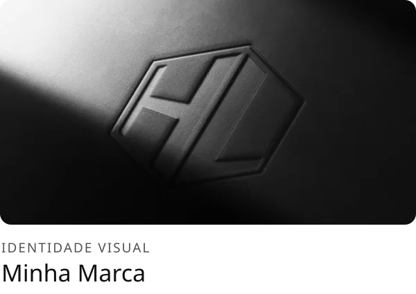
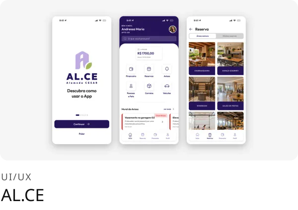

<a href="https://humbertolima.design">
  <picture>
    <source media="(prefers-color-scheme: dark)" srcset="assets/banner-dark.svg" />
    
  </picture>
</a>

 

Estudante de Design na CESAR School, com formação anterior em Ciência da Computação. Trabalho no encontro entre os dois: interfaces, identidade visual e protótipos que saem da tela, do Figma ao Arduino.

Bolsista CNPq em robótica e robótica subaquática no CREATE@CESAR. Já fui monitor de Sistemas Digitais e ministrei oficinas de Figma pelo Núcleo de Design (NdD) da CESAR.

  
  
  

 

### Projetos

  <a href="https://humbertolima.design/projects/minha-marca"><picture><source media="(prefers-color-scheme: dark)" srcset="assets/projetos/card-minha-marca-dark.svg" /></picture></a>
  <a href="https://humbertolima.design/projects/alce"><picture><source media="(prefers-color-scheme: dark)" srcset="assets/projetos/card-alce-dark.svg" /></picture></a>

  

 

### Ferramentas

  
  
  
  
  
  

 

<picture>
  <source media="(prefers-color-scheme: dark)" srcset="https://github-stats-extended.vercel.app/api?username=gaseet&show_icons=true&include_all_commits=true&hide_border=true&bg_color=101010&title_color=fafafa&text_color=a3a3a3&icon_color=fafafa&ring_color=fafafa" />
  
</picture>
<picture>
  <source media="(prefers-color-scheme: dark)" srcset="https://github-stats-extended.vercel.app/api/top-langs?username=gaseet&layout=compact&langs_count=4&hide_border=true&bg_color=101010&title_color=fafafa&text_color=a3a3a3" />
  
</picture>
