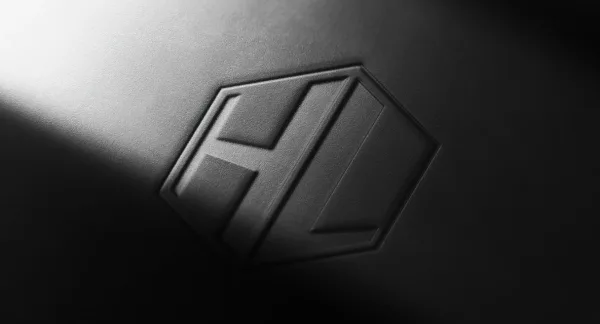
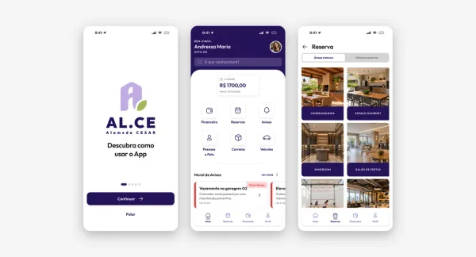
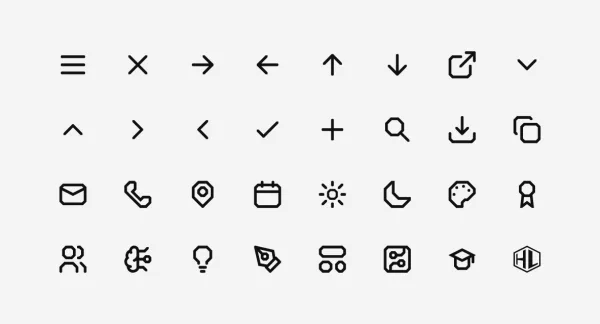
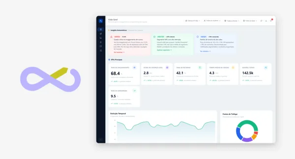
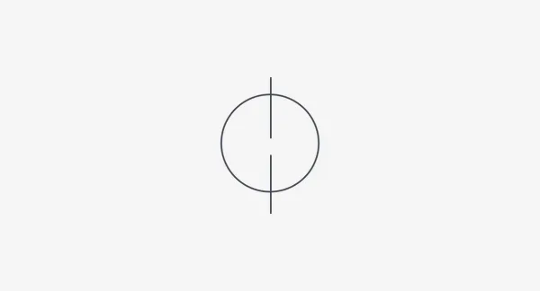
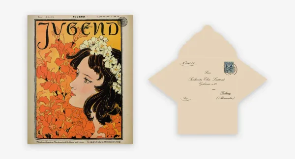

<a href="https://humbertolima.design">
  <picture>
    <source media="(prefers-color-scheme: dark)" srcset="assets/banner-dark.svg" />
    
  </picture>
</a>

 

Estudante de Design na CESAR School, com formação anterior em Ciência da Computação. Trabalho no encontro entre os dois: interfaces, identidade visual e protótipos que saem da tela, do Figma ao Arduino.

Bolsista CNPq em robótica e robótica subaquática no CREATE@CESAR, monitor de Sistemas Digitais e parte do Núcleo de Design (NdD).

  
  
  

 

### Projetos

<table>
  <tr>
    <td width="50%" valign="top">
      
       IDENTIDADE VISUAL 
      <a href="https://humbertolima.design/projects/minha-marca"><b>Minha Marca</b></a> 
      Um hexágono tirado da quina de uma parede, com o H e o L encaixados em perspectiva.
    </td>
    <td width="50%" valign="top">
      
       UI/UX 
      <a href="https://humbertolima.design/projects/alce"><b>AL.CE</b></a> 
      App de condomínio para o Edifício Alameda CESAR, do style guide ao protótipo de alta fidelidade.
    </td>
  </tr>
  <tr>
    <td width="50%" valign="top">
      
       DESIGN DE ÍCONES 
      <a href="https://humbertolima.design/projects/minha-icon-family"><b>Minha Icon Family</b></a> 
      26 ícones derivados da marca, com a mesma gramática da logo HL.
    </td>
    <td width="50%" valign="top">
      
       UI/UX 
      <a href="https://humbertolima.design/projects/flux"><b>FLUX</b></a> 
      Dashboard para o SEBRAE/PE entender a experiência do cliente pelos sinais da navegação.
    </td>
  </tr>
  <tr>
    <td width="50%" valign="top">
      
       DESIGN ESPECULATIVO 
      <a href="https://humbertolima.design/projects/syndream"><b>SynDream</b></a> 
      Kit para voltar à realidade depois de uma festa vivida em sonho, em 2089.
    </td>
    <td width="50%" valign="top">
      
       DESIGN EDITORIAL 
      <a href="https://humbertolima.design/projects/violetas-de-elise"><b>As Violetas de Elise</b></a> 
      Livro de artista em forma de caixa de memórias, contado por cartas e objetos.
    </td>
  </tr>
</table>

<a href="https://humbertolima.design/projects">Ver todos os projetos →</a>

### Ferramentas

Figma · InDesign · React · TypeScript · Python · Arduino

 

<picture>
  <source media="(prefers-color-scheme: dark)" srcset="https://github-stats-extended.vercel.app/api?username=gaseet&show_icons=true&include_all_commits=true&hide_border=true&bg_color=101010&title_color=fafafa&text_color=a3a3a3&icon_color=fafafa&ring_color=fafafa" />
  
</picture>
<picture>
  <source media="(prefers-color-scheme: dark)" srcset="https://github-stats-extended.vercel.app/api/top-langs?username=gaseet&layout=compact&langs_count=4&hide_border=true&bg_color=101010&title_color=fafafa&text_color=a3a3a3" />
  
</picture>
